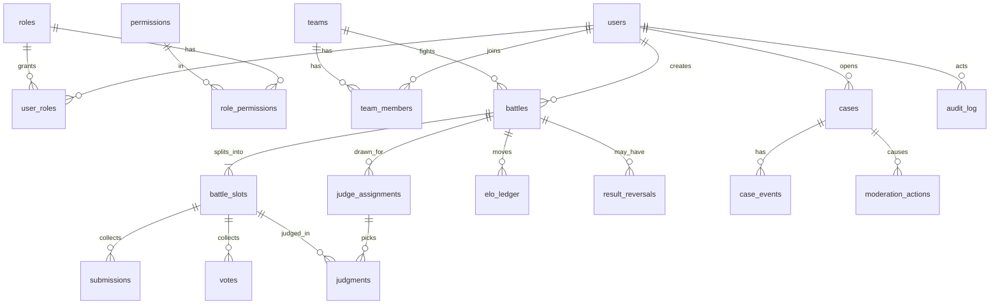

# GlovesUP V1 Data Model

Doc: 02-data-model. Related: 01-feature-spec (F- IDs), 03-state-flows (timers and statuses), 04-permissions-matrix.
Last updated: Nov 13, 2026. Owner: Matt.

## Conventions (read first)
- `†` marks a detail inferred and not yet confirmed. Everything without `†` is decided.
- Types: `uuid`, `text`, `integer`, `boolean`, `timestamp`, `json`, `bytes`, `enum`. Database is Postgres.
- Every table has an `id uuid` primary key unless stated otherwise. Foreign keys are named `<table>_id` or `<role>_id` and point at `id`.
- "On deletion" column (account deletion, F-A5): **Delete** removes it, **Anon** replaces it with the Hung Up placeholder, **Keep** leaves it so history stays intact.
- A call out and a battle are one table. A call out is a battle in the `proposed` state.

## Entity map
This diagram was reconstructed from the field lists below. Check it against the tables if they ever disagree: the tables win.

## 1. Accounts and profiles

### users
| Field | Type | Notes | On deletion |
|---|---|---|---|
| id | uuid | Primary key. Every other table points here | Keep |
| username | text, unique | Banned-word checked | Anon |
| glover_name | text | Always public | Anon |
| email | text, unique | Never shown to other users | Delete |
| email_verified_at | timestamp | Null until verified | Delete |
| password_hash | text | | Delete |
| dob_encrypted | bytes | Encrypted, not hashed, so age checks still work. Never displayed | Delete |
| age_gate_passed | boolean | Computed at signup (13 or older) | Keep |
| mfa_secret, recovery_codes | bytes | Required for staff | Delete |
| avatar_url, bio | text | Avatar is always public | Delete |
| status | enum | active, suspended, banned, deleted | Keep (set to deleted) |
| elo_rating | integer | Starts at 1000. Cached copy of the latest ledger row | Keep |
| created_at, deleted_at | timestamp | | Keep |

### profile_settings
| Field | Type | Notes | On deletion |
|---|---|---|---|
| user_id | uuid | One row per user | Delete |
| hidden_fields | json | Fields the user chose to hide. Avatar, username, Glover name and battle history cannot be hidden | Delete |
| social_links_public | boolean | One public or private toggle for all links | Delete |

### social_links
| Field | Type | Notes | On deletion |
|---|---|---|---|
| user_id | uuid | | Delete |
| platform | enum | youtube, instagram, tiktok, facebook, x, discord, twitch, website | Delete |
| url | text | Max 5 rows per user. `position integer` orders them | Delete |

### sessions and blocks
| Table | Fields | On deletion |
|---|---|---|
| sessions | user_id, device, ip, last_seen_at, revoked_at | Delete |
| blocks | blocker_id, blocked_id, created_at | Delete |

### user_roles
| Field | Type | Notes |
|---|---|---|
| user_id, role_id | uuid | Links a user to a role |
| scope_type, scope_id | text, uuid | Null for site-wide roles. Team roles carry the team id |
| granted_by, granted_at | uuid, timestamp | Who assigned it |

## 2. Teams
Teams are never hard-deleted. A deleted team is archived so battle history stays readable.

### teams
| Field | Type | Notes |
|---|---|---|
| id | uuid | |
| name, description, avatar_url | text | Edited by owner and officers |
| owner_id | uuid | Points to users. Changes on ownership transfer |
| elo_rating | integer | One score for the whole team. Starts at 1000 |
| status | enum | active or archived |
| created_at, archived_at | timestamp | |

### team_members
| Field | Type | Notes |
|---|---|---|
| team_id, user_id | uuid | One row per membership |
| role | enum | member or officer. The owner is `teams.owner_id` |
| status | enum | active, suspended, banned, left, removed |
| joined_at, ended_at | timestamp | |
| ended_by | uuid | Who removed or banned them. Null when they left |

### team_applications and team_invites
| Field | Type | Notes |
|---|---|---|
| team_id, user_id | uuid | |
| message | text | Applications only. Fixed form with a message in V1 |
| invited_by | uuid | Invites only |
| status | enum | pending, approved, denied, withdrawn, accepted, declined, expired † |
| decided_by, decided_at | uuid, timestamp | |

### team_change_log
| Field | Type | Notes |
|---|---|---|
| team_id, changed_by | uuid | Every profile and roster change is logged by user |
| field, old_value, new_value | text | |
| changed_at | timestamp | |

## 3. Battles, submissions, judging, ELO
Every battle has one or more slots. A 1v1 has one slot. A team battle has three, each a pairing judged on its own.

### battles
| Field | Type | Notes |
|---|---|---|
| kind | enum | single or team |
| scoring | enum | elo or fun. Set at draft, locked after acceptance |
| judging | enum | official or popular. Set at draft. ELO battles must be official |
| challenger_user_id, opponent_user_id | uuid | Single battles |
| challenger_team_id, opponent_team_id | uuid | Team battles |
| created_by | uuid | Who sent the call out |
| status | enum | proposed, accepted, declined, cancelled, expired, awaiting_panel, submissions_open, judging, finalized, forfeited, voided, stuck † |
| elo_band_ok | boolean | Opponent was within 400 ELO at creation † |
| submission_days | integer | 3, 5, or 7, chosen by the creator from a dropdown |
| expires_at | timestamp | Creation plus 72 hours |
| accepted_at, submissions_due_at, judging_due_at, finalized_at | timestamp | Due dates computed from acceptance and from the second submission |
| result | enum | challenger, opponent, or void |
| forfeited_by | uuid | User or team that forfeited, or null |
| forfeit_reason | enum | explicit or missed_deadline |

`awaiting_panel` means the 3 judges have not all accepted yet. Submissions can still open while a battle is in this state.

### battle_slots
| Field | Type | Notes |
|---|---|---|
| battle_id | uuid | |
| position | integer | 1 to 3. Pairs first listed vs first listed, and so on |
| challenger_user_id, opponent_user_id | uuid | Who fights in this slot |
| result | enum | challenger, opponent, or void |

### submissions
| Field | Type | Notes |
|---|---|---|
| slot_id, user_id | uuid | |
| youtube_url, video_id | text | YouTube links only |
| title_snapshot, thumbnail_snapshot | text | Saved at submission so a dead link still shows context |
| status | enum | submitted, replaced, cancelled, dead_link |
| last_checked_at | timestamp | Last time the link was re-checked (see 03-state-flows) |
| submitted_at, locked_at | timestamp | |

### judge_assignments
One panel of three judges per battle. A team battle uses the same three for all its slots.
| Field | Type | Notes |
|---|---|---|
| battle_id, judge_user_id | uuid | Three active judges per battle |
| status | enum | drawn, accepted, declined, recused, replaced, scored |
| drawn_at, respond_by | timestamp | Judges have 48 hours to accept before replacement |
| score_due_at | timestamp | Five days after both videos are in |
| replaced_by, replaced_reason | uuid, text | Moderators and admins can sub in |

### judgments
One row per judge per slot. A 1v1 has one row per judge; a team battle has three.
| Field | Type | Notes |
|---|---|---|
| assignment_id, slot_id | uuid | |
| pick | enum | challenger or opponent. Required |
| reason_text | text | Typed reason. At least one of reason_text or reason_video_url is required |
| reason_video_url, reason_video_id | text | YouTube link to the judge's review video. Same format and oEmbed checks as battle videos |
| submitted_at, reasons_public_at | timestamp | Reasons become public once all judging is complete |

### votes (popular vote)
| Field | Type | Notes |
|---|---|---|
| slot_id, voter_id | uuid | One vote per account per slot |
| choice | enum | challenger or opponent |
| cast_at | timestamp | |
| source_hash | text | Hashed IP or device, used only to flag bursts † |
| voided_at, voided_by | timestamp, uuid | Admins can void and recompute |

### elo_ledger
Append-only.
| Field | Type | Notes |
|---|---|---|
| subject_type, subject_id | enum, uuid | user or team |
| battle_id | uuid | Null for manual adjustments |
| rating_before, rating_after, delta, k_factor | integer | K is 32 |
| reason | enum | result, forfeit, appeal_reversal, adjustment |
| created_at, created_by | timestamp, uuid | |

The current rating on users and teams is a cached copy of the latest ledger row. A reversed appeal adds ledger rows for that battle only and does not recalculate later battles.

### result_reversals
A result can change only through this table, and only after two different admins approve.
| Field | Type | Notes |
|---|---|---|
| battle_id, case_id | uuid | Linked to the appeal or dispute case |
| proposed_result | enum | challenger, opponent, or void |
| requested_by | uuid | An admin. Counts as approval 1 |
| approved_by | uuid | A second, different admin. The site owner can be either. Must differ from requested_by |
| status | enum | pending, approved, rejected, withdrawn |
| requested_at, decided_at | timestamp | |

## 4. Cases, roles, audit

### cases and case_events
| Field | Type | Notes |
|---|---|---|
| type | enum | ticket, bug, report_user, report_content, result_dispute, appeal, judge_complaint, data_request |
| subject_type, subject_id | enum, uuid | User, submission, battle, or none |
| reporter_id, assignee_id | uuid | Reporter may be null for a logged-out ticket † |
| status | enum | open, assigned, waiting_on_user, resolved, closed. Reopen returns it to open |
| opened_at, closed_at | timestamp | |
| case_events | case_id, actor_id, kind, body, is_internal, created_at | Comments, status changes, assignments. Internal notes are staff-only |

### moderation_actions
| Field | Type | Notes |
|---|---|---|
| target_user_id | uuid | |
| type | enum | warn, suspend, ban, lift |
| reason, case_id | text, uuid | Linked to the case that caused it |
| starts_at, ends_at | timestamp | Null end means open-ended |
| created_by | uuid | Moderator or admin |

### roles, permissions, role_permissions
| Table | Fields | Notes |
|---|---|---|
| roles | id, key, name, scope_type | Scope is site or team. Adding a role is a data insert |
| permissions | id, key, description | One row per action in 04-permissions-matrix |
| role_permissions | role_id, permission_id | Changing what a role can do is an edit here, not a code change |

### judge_applications
| Field | Type | Notes |
|---|---|---|
| user_id, statement | uuid, text | |
| status | enum | pending, approved, denied, withdrawn |
| approvals | application_id, admin_id, decision, decided_at | Two admin approvals required. A super admin's direct assignment skips this table and is audit-logged |

### banned_words and scheduled_jobs
| Table | Fields | Notes |
|---|---|---|
| banned_words | id, word, added_by, added_at | Checked on names and bios |
| scheduled_jobs | id, kind, run_at, payload, status † | Powers the timers. A one-minute worker runs due rows (see 03-state-flows) |

### notifications
| Field | Type | Notes |
|---|---|---|
| user_id | uuid | |
| template, payload | text, json | Email only in V1 |
| status, sent_at | enum, timestamp | queued, sent, failed |

### audit_log
Append-only. No update or delete in application code.
| Field | Type | Notes |
|---|---|---|
| actor_id | uuid | Null for system actions |
| action | text | create_battle, ban_user, assign_role, and so on |
| object_type, object_id | text, uuid | |
| before, after | json | Snapshots. Personal values are redacted before storing † |
| ip_hash, created_at | text, timestamp | |

## 5. Deletion and anonymization
When a user deletes their account, every identifying field is removed and battle history stays. The account becomes the Hung Up placeholder: a pair of darkened gloves hanging over a wire, in muted monochrome.

| Data | Action | Reason |
|---|---|---|
| Email, password hash, encrypted DOB, MFA secrets, sessions | Hard delete | Identifies the person |
| Avatar, bio, social links, profile settings, blocks | Hard delete | Personal content |
| Username and Glover name | Replace with Hung Up placeholder | History needs a name to show |
| Battles, slots, judgments, scores | Keep | Battle history preservation |
| Submissions (link, title, thumbnail) | Keep † | Part of the battle record. A dead link shows the gravestone |
| ELO ledger | Keep | Ratings stay consistent. The account leaves leaderboards |
| Team memberships | End the membership, keep the row | Team history stays readable |
| Audit log | Keep, personal values redacted from before/after † | Oversight needs the trail |
| Case records the user opened | Keep, personal text redacted † | Staff need the outcome |
| Backups | Deletion is complete once the backup retention window passes † | Backups cannot be edited |

Before anonymizing, the system checks:
1. A team owner must first transfer the team or delete it. An owner cannot leave with other members still in the team.
2. Battles still in progress are forfeited so opponents are not left waiting †.
3. An admin confirms the deletion in the data request case, and the confirmation is audit-logged (F-H4).
