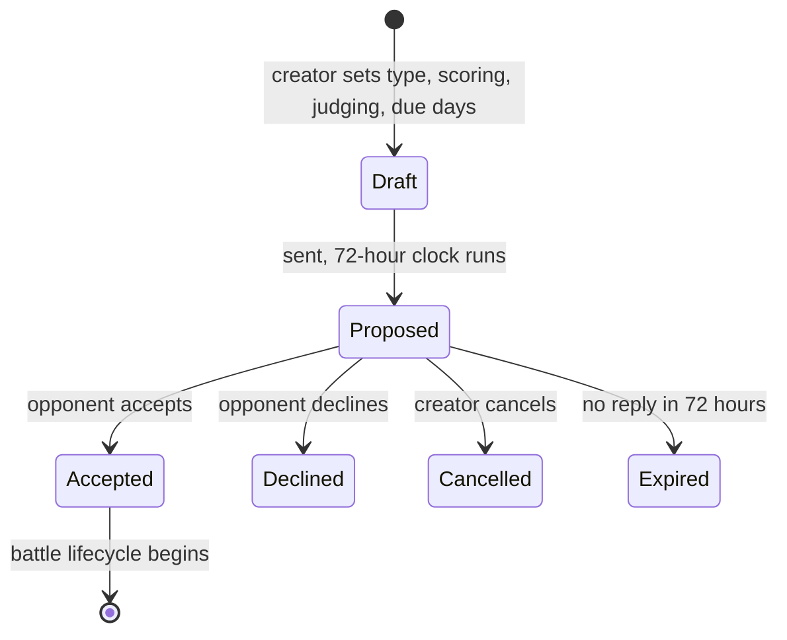
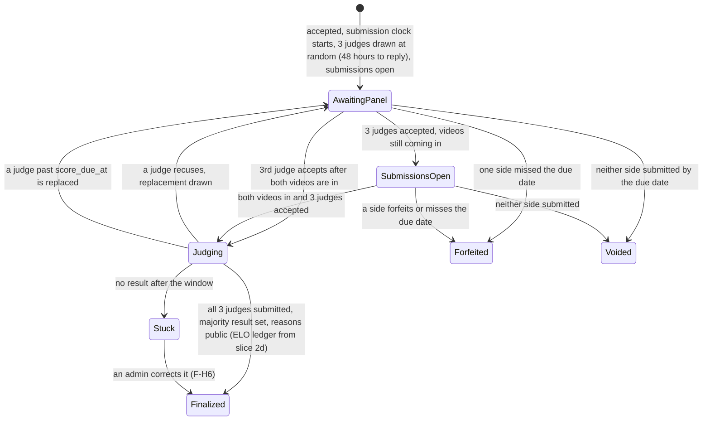
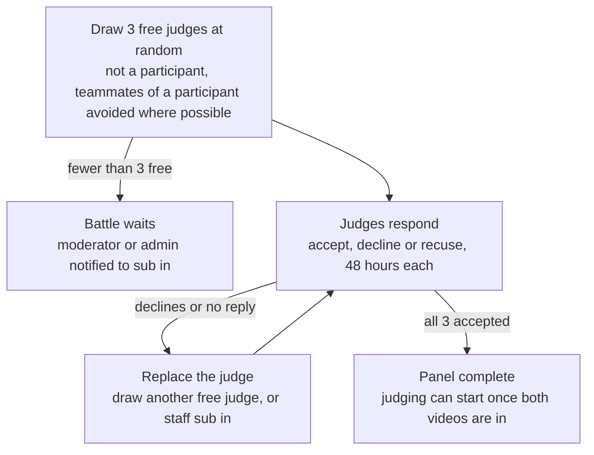
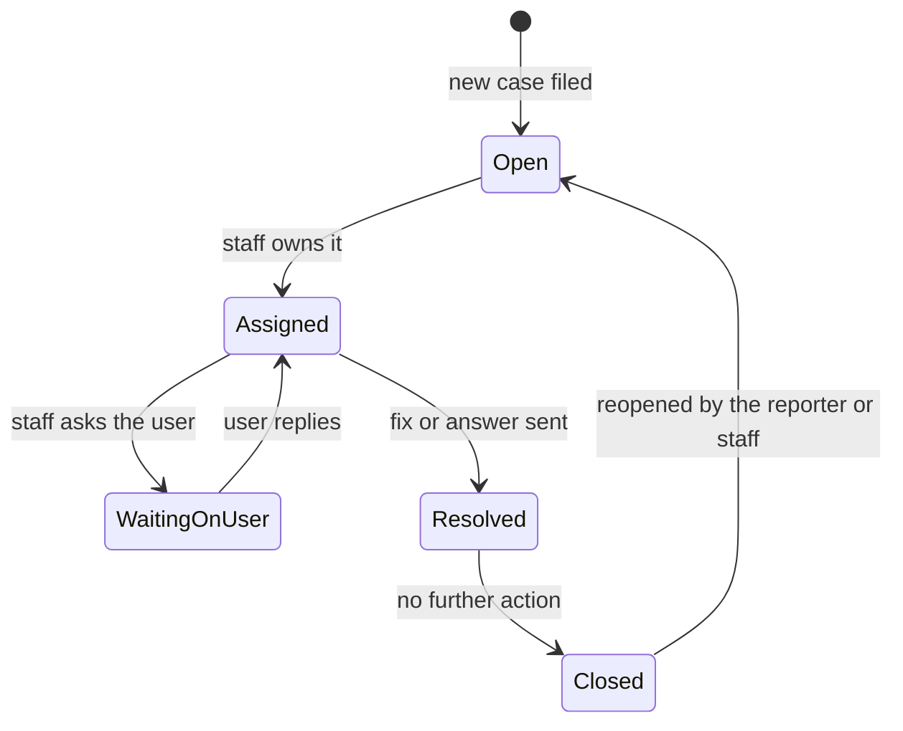

# GlovesUP V1 State Flows

Doc: 03-state-flows. Related: 01-feature-spec, 02-data-model (status enums), 04-permissions-matrix.
Last updated: Nov 25, 2026 (worker slice). Owner: Matt.

## Conventions (read first)
- `†` marks a detail inferred and not yet confirmed. Everything without `†` is decided.
- Every deadline below is a due column on its row (no `scheduled_jobs` table). The one-minute worker sweeps the columns and makes the state change when a deadline runs out (section 8).
- Status names match the enums in 02-data-model.

## 1. Timers and clocks
| Clock | Starts when | Length | If it runs out |
|---|---|---|---|
| Call out | The call out is sent | 72 hours | The call out expires (`expired`). No penalty in V1 |
| Judge response | A judge is drawn | 48 hours | The judge is replaced (`replaced`, reason `no_reply`) by another random free judge, who gets their own 48 hours. If none is free, the judge keeps the seat and a late reply is still taken; the battle shows in the daily stuck report. Moderators and admins sub in from their own slice (no notice until F-H7) |
| Submission due date | The opponent accepts | 3, 5, or 7 days, chosen by the creator | One side in (a `dead_link` video counts as in): the other side forfeits (`forfeited`, `missed_deadline`, result = the side that submitted, the lone video locks at the due time). Neither in: `voided`, result void, no ELO change. `finalized_at` is the due time in both. Official and popular vote battles alike |
| Judge decision | Both videos are submitted and the 3 judges have accepted (`score_due_at` per judge; `judging_due_at` is the latest on the panel) | 5 days | The judge is replaced (`replaced`, reason `no_pick`) and the battle goes back to `awaiting_panel`; the new judge gets a fresh 5 days when the battle re-enters judging, and the others keep theirs (Matt, Nov 25, 2026). If no judge is free, the judge keeps the seat and a late pick is still taken. `judging_due_at` itself triggers nothing |
| Popular vote | Both videos are submitted | Until the 5-day judging window ends | Voting closes. Results stay hidden until then |
| Judge reasons | All judging is complete | Immediate | Reasons (text and review videos) become public |

The submission clock starts at acceptance, so judge responses can still be pending while submissions come in. Judging waits for the 3 accepted judges and both videos (Matt, Nov 25, 2026).

## 2. Call out lifecycle
A call out is a battle in the `proposed` state. The creator can edit it until the opponent accepts. Team call outs follow the same path, with the opposing team's officers answering.

Repeated expiries will carry a penalty later (F-C9, V2). Expiry has none in V1.

## 3. Battle lifecycle
One main path to a result, with three ways out.

- Status names: `awaiting_panel` (fewer than 3 judges hold a seat; a seat is an accepted or scored assignment), `submissions_open` (panel complete), `judging` (panel complete and both videos in). The `accepted` status is never stored; accept moves a call out straight to `awaiting_panel` (slice 2c-1).
- Every status move (judge accept or decline, video submit or cancel) runs in one transaction holding the battle row lock, so the last judge accept and the last video cannot race.
- Finalize (slice 2c-2) runs in the transaction of the third judgment: each slot gets the majority of its 3 picks, the battle gets the slot result (team battles: 2 of 3 pairings), status `finalized`, `finalized_at`, and `reasons_public_at` on every judgment. Never on fewer than 3 picks: a 1-1 split waits for the third judge, and a battle with no replacement becomes stuck (F-H6). A judgment already submitted always counts, even if the judge is later revoked or banned. ELO does not move until slice 2d, which adds its ledger rows inside finalize, in the same transaction (Matt, Nov 25, 2026).
- A forfeit can be called at any point before the result is final. On ELO battles it counts as a loss. The worker forfeits a side that missed the due date (worker slice); the Forfeit button (F-C6, S-B6) comes in a later slice. Slice 2d adds ledger rows (reason `forfeit`) at the "Slice 2d hook" in `closeSubmissions()` in `lib/worker.js`; a void adds none.
- Stuck (F-H6): there is no `stuck` status yet. A battle is stuck when it is in play and its official panel is short, or a judge is past `respond_by` or `score_due_at` with nobody free to replace them. The worker logs them once a day (12:00 UTC). They recover by themselves when a judge becomes free. The status and S-S10 come with F-H6.
- A reversed appeal does not move the battle backward. It adds ELO ledger rows for this battle only. Later battles are not changed.
- Reversal needs two different admins (see section 5).

## 4. Judge panel
Judges are drawn at random from free judges. Neither side picks, approves or replaces them.

- A free judge holds the judge role, is active and verified, is not a player in the battle, and has no assignment on that battle already, in any status (so a judge who declined is never drawn again for it). There is no cap on how many battles one judge holds (Matt, Nov 25, 2026).
- Panels are drawn only for battles with Official judges. A Popular vote battle gets no panel and stays `awaiting_panel` until the popular vote slice sets its own status flow (Matt, Nov 25, 2026).
- Fewer than 3 free judges: the draw takes who exists and accept never fails. The worker tops up every official panel in play with fewer than 3 live judges (drawn, accepted or scored) each minute.
- A decline draws the replacement at once, with no timer.
- Players see each judge's status (Waiting for reply, Accepted, Judged), never names or picks. A judge sees only their own assignment and judgment. After finalize the outcome names each judge with their pick and reason (Matt, Nov 25, 2026).
- Picking (slice 2c-2): an accepted judge picks once both videos are locked, in `judging`, or in `awaiting_panel` after a co-judge recused. Submitting locks the judgment (status `scored`).
- Recusal (slice 2c-2): only an accepted judge who has not submitted, while the battle is `awaiting_panel`, `submissions_open` or `judging`. A drawn judge uses Decline. The assignment becomes `recused` (`recused_at`), a replacement is drawn at once (none if nobody is free; the battle waits), and the battle goes back to `awaiting_panel`. `judging_due_at` and the other judges' `score_due_at` do not change. When the battle re-enters `judging`, only seated judges without a `score_due_at` get now + 5 days, and `judging_due_at` becomes the latest `score_due_at` on the panel. A recused judge is never drawn again for that battle.
- A moderator or admin cannot sub in on a battle they are in †.
- In a team battle the same 3 judges score all three pairings.

## 5. Result reversal
Only way to change a finalized result.
1. An admin starts a reversal request on an appeal or dispute case. This counts as approval 1.
2. A second, different admin approves. The site owner can be either admin.
3. On the second approval the result changes and ELO ledger rows are added for that battle only.
4. Every step is audit-logged. Moderators can recommend a reversal in case notes only. Nobody else can reverse a result.

## 6. Case lifecycle
Reports, disputes, appeals, bugs, tickets, and data requests all use these states. The case type decides who sees it first: moderators for conduct and content, admins for account and data issues.

Internal staff notes can be added in any state and never show to the reporter.

## 7. Account deletion
A deletion request ends with the account anonymized as Hung Up and a logged confirmation. Data rules are in 02-data-model, section 5.
1. The user asks to delete their account and re-enters their password and MFA code.
2. The system checks for blockers. A team owner must first pass ownership to an officer, or delete the team if they are its only member. Battles still in progress are forfeited so opponents are not left waiting †.
3. A data request case opens, and an admin confirms the deletion.
4. The system hard-deletes email, password hash, encrypted DOB, MFA secrets, sessions, avatar, bio, social links, profile settings, and blocks.
5. Username and Glover name are replaced with the Hung Up placeholder. Battles, judgments, and the ELO ledger stay.
6. The account leaves leaderboards and team rosters. Team membership rows end but are kept.
7. The audit log records the deletion, the confirming admin, and the time. The user gets a final confirmation email before the address is deleted †.

## 8. Implementation decisions
- **Timers (worker slice, Matt, Nov 25, 2026).** No `scheduled_jobs` table: one small worker (`scripts/worker.js`, `lib/worker.js`) runs every minute from cron under `flock -n` and sweeps the due columns, which stay the only record of each deadline. It returns only if email retries need it (F-H7). Each run, in order: expire call outs; close submissions (forfeit or void); replace judges past `respond_by`; replace judges past `score_due_at`; top up short panels; recheck videos. A deadline counts as passed at the due time itself (due <= now).
  - Safety: `flock -n` and a Postgres advisory lock, so runs never overlap. Each battle runs in its own transaction holding the battle row lock and checks its condition again under the lock, so a repeated run, or a player or judge acting at the same moment, never changes a battle twice. A crash rolls back that battle only; the next minute redoes it. One battle failing is logged and the run goes on (exit code 1).
  - Replacements need a free judge (same rule as the draw). Without one the judge keeps the seat.
  - Logs: one line per change on stdout, ids only (never usernames or emails); errors on stderr; a heartbeat at minute 0 of each hour; the stuck report at 12:00 UTC. Cron appends to `/var/log/glovesup/worker.log`, rotated daily by logrotate (14 kept).
  - The clock is passed in (`now`), so tests set it; the script always uses the real clock.
- **YouTube checks.** No API key.
  1. On submit, check the URL format server-side: watch, youtu.be and shorts links.
  2. Ask YouTube's public oEmbed endpoint whether the video exists and is viewable. It also returns the title and thumbnail, which are saved as the snapshots. No answer within 5 seconds, or any reply other than a video or a 400/401/403/404, means YouTube could not be reached: the video is refused with "Couldn't check the video, try again." and nothing is saved.
  3. Once a day, re-check saved videos for battles that are not yet over (live submissions on battles in `awaiting_panel`, `submissions_open` or `judging`): each video 24 hours after its last check (or its submit), at most 20 per minute, one at a time; 3 unreachable answers in a row end that run's checks. A dead answer sets the submission to `dead_link` and the gravestone shows; a later live answer sets it back to `submitted`. Unreachable changes nothing. Saved titles and thumbnails never change. Judge review videos are not rechecked (Matt, Nov 25, 2026).
  4. Private, deleted and embedding-disabled videos all count as dead.
- **Email.** Gmail, once the site is ready (F-H7). Provider details and templates to be settled then.
- **ELO testing.** Save test cases for after the workflow runs end to end.
