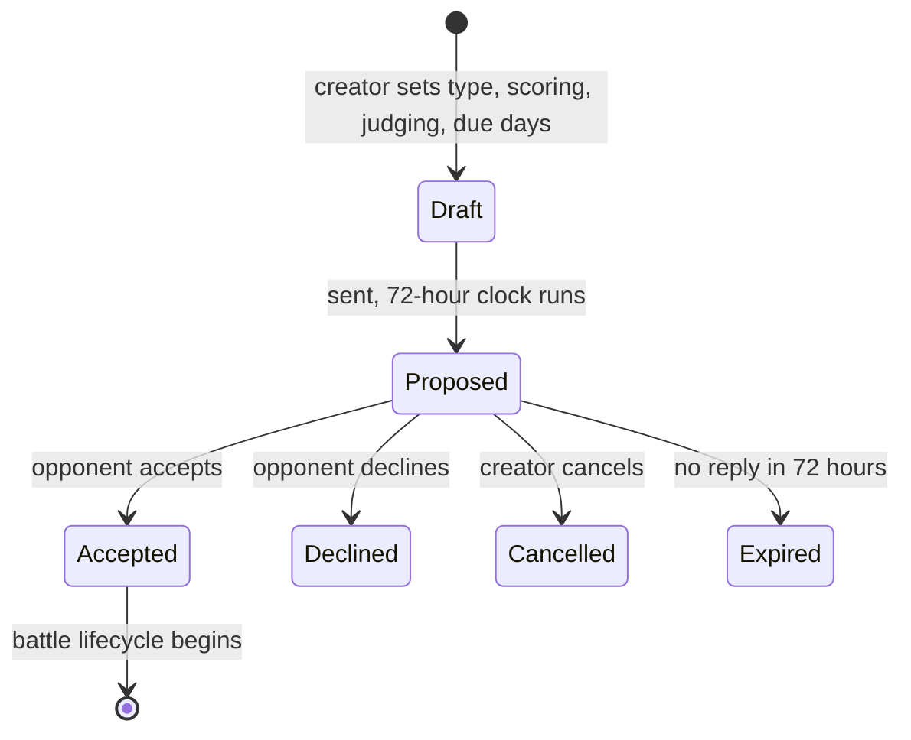
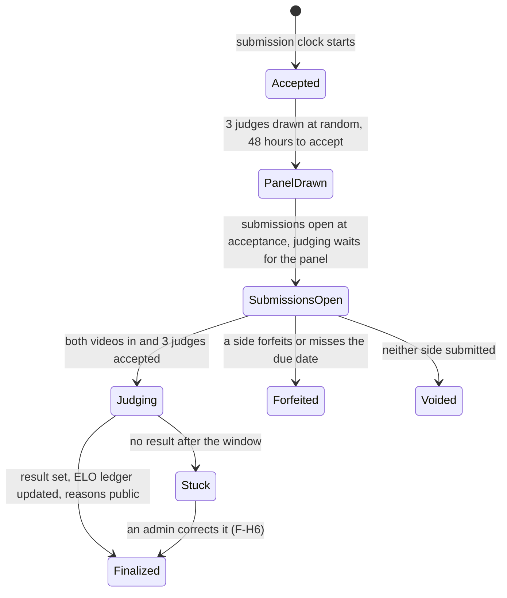
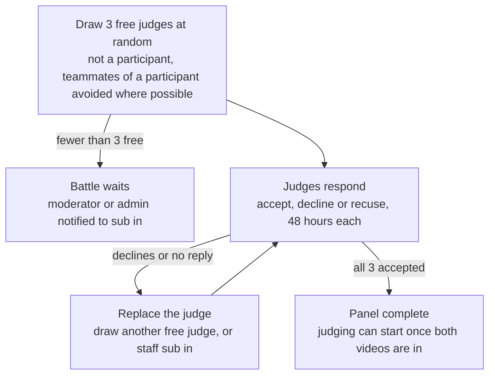
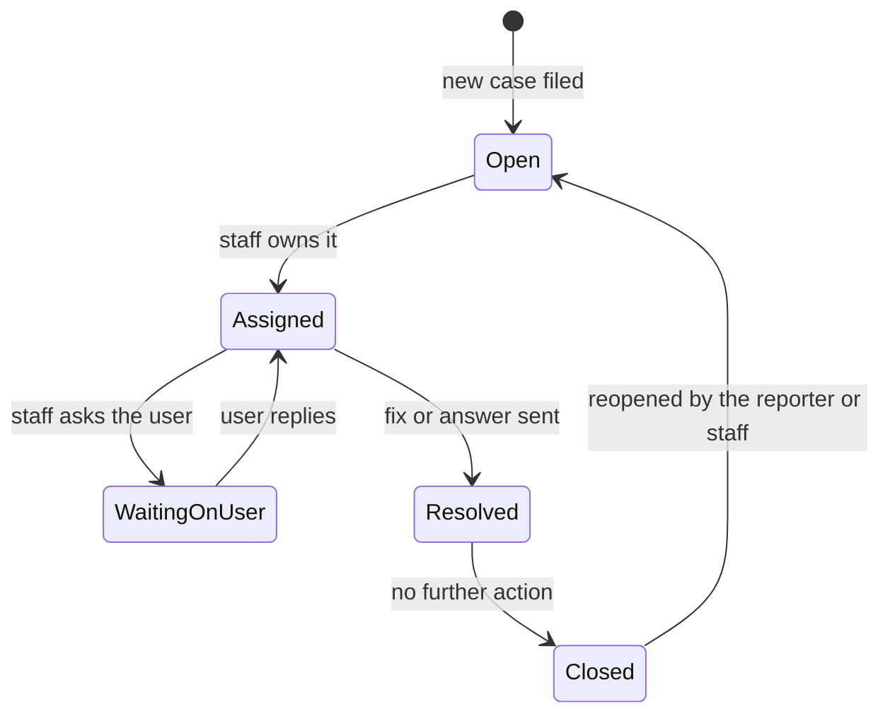

# GlovesUP V1 State Flows

Doc: 03-state-flows. Related: 01-feature-spec, 02-data-model (status enums), 04-permissions-matrix.
Last updated: Nov 13, 2026. Owner: Matt.

## Conventions (read first)
- `†` marks a detail inferred and not yet confirmed. Everything without `†` is decided.
- Every deadline below is a row in `scheduled_jobs` and a state change when it runs out.
- Status names match the enums in 02-data-model.

## 1. Timers and clocks
| Clock | Starts when | Length | If it runs out |
|---|---|---|---|
| Call out | The call out is sent | 72 hours | The call out expires. No penalty in V1 |
| Judge response | A judge is drawn | 48 hours | The judge is replaced by another random free judge. If none is free, the battle waits and a moderator or admin is notified to sub in |
| Submission due date | The opponent accepts | 3, 5, or 7 days, chosen by the creator | If one side is missing, that side forfeits. If neither submitted, the battle is voided with no ELO change |
| Judge decision | Both videos are submitted and the 3 judges have accepted † | 5 days | The judge is replaced and the new judge gets a fresh 5 days † |
| Popular vote | Both videos are submitted | Until the 5-day judging window ends | Voting closes. Results stay hidden until then |
| Judge reasons | All judging is complete | Immediate | Reasons (text and review videos) become public |

The submission clock starts at acceptance, so judge responses can still be pending while submissions come in. Judging waits for the 3 accepted judges and both videos †.

## 2. Call out lifecycle
A call out is a battle in the `proposed` state. The creator can edit it until the opponent accepts. Team call outs follow the same path, with the opposing team's officers answering.

Repeated expiries will carry a penalty later (F-C9, V2). Expiry has none in V1.

## 3. Battle lifecycle
One main path to a result, with three ways out.

- A forfeit can be called at any point before the result is final. On ELO battles it counts as a loss.
- A reversed appeal does not move the battle backward. It adds ELO ledger rows for this battle only. Later battles are not changed.
- Reversal needs two different admins (see section 5).

## 4. Judge panel
Judges are drawn at random from free judges. Neither side picks, approves or replaces them.

- A moderator or admin cannot sub in on a battle they are in †.
- In a team battle the same 3 judges score all three pairings.

## 5. Result reversal
Only way to change a finalized result.
1. An admin starts a reversal request on an appeal or dispute case. This counts as approval 1.
2. A second, different admin approves. The site owner can be either admin.
3. On the second approval the result changes and ELO ledger rows are added for that battle only.
4. Every step is audit-logged. Moderators can recommend a reversal in case notes only. Nobody else can reverse a result.

## 6. Case lifecycle
Reports, disputes, appeals, bugs, tickets, and data requests all use these states. The case type decides who sees it first: moderators for conduct and content, admins for account and data issues.

Internal staff notes can be added in any state and never show to the reporter.

## 7. Account deletion
A deletion request ends with the account anonymized as Hung Up and a logged confirmation. Data rules are in 02-data-model, section 5.
1. The user asks to delete their account and re-enters their password and MFA code.
2. The system checks for blockers. A team owner must first pass ownership to an officer, or delete the team if they are its only member. Battles still in progress are forfeited so opponents are not left waiting †.
3. A data request case opens, and an admin confirms the deletion.
4. The system hard-deletes email, password hash, encrypted DOB, MFA secrets, sessions, avatar, bio, social links, profile settings, and blocks.
5. Username and Glover name are replaced with the Hung Up placeholder. Battles, judgments, and the ELO ledger stay.
6. The account leaves leaderboards and team rosters. Team membership rows end but are kept.
7. The audit log records the deletion, the confirming admin, and the time. The user gets a final confirmation email before the address is deleted †.

## 8. Implementation decisions
- **Timers.** Keep the `scheduled_jobs` table. One small worker runs every minute (cron or a systemd timer), picks up rows where `run_at` has passed and `status` is pending, runs them, and marks them done. Jobs survive restarts. No extra services.
- **YouTube checks.** No API key.
  1. On submit, check the URL format server-side: watch, youtu.be and shorts links.
  2. Ask YouTube's public oEmbed endpoint whether the video exists and is viewable. It also returns the title and thumbnail, which are saved as the snapshots.
  3. Once a day, re-check saved videos for battles that are not yet finalized. A failed check sets the submission to `dead_link` and the gravestone shows.
  4. Private, deleted and embedding-disabled videos all count as dead.
- **Email.** Gmail, once the site is ready (F-H7). Provider details and templates to be settled then.
- **ELO testing.** Save test cases for after the workflow runs end to end.
