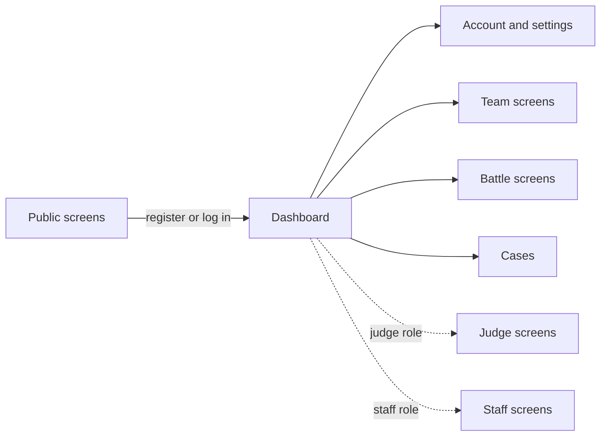

# GlovesUP V1 Screen Inventory

Doc: 05-screen-inventory. Related: 01-feature-spec (F- IDs), 04-permissions-matrix (who sees what). The drawn wireframes show what is done; remaining gaps are in OPEN_ITEMS.md.
Last updated: Nov 13, 2026. Owner: Matt.

## Conventions (read first)
- Screen IDs use the `S-` prefix (example: `S-B1`). Feature IDs use `F-` (example: `F-B1` is Create team; `S-B1` is Create call out).
- `†` marks a detail inferred and not yet confirmed.
- V1 has 46 screens in 6 areas. Staff and judge areas appear only for people who hold those roles. Visitors stay in the public screens until they register or log in; members then work from the dashboard.
- Wireframes and the themed HTML for the key screens live in the wireframe package. Layout comes from the wireframe; behavior comes from 01-feature-spec.

## Design rules
- **Dropdowns over typing.** Use a dropdown or toggle whenever the answer comes from a fixed set: due date (3, 5 or 7 days), format, scoring, judging type, sort, filters, social link platform. Typed text only for names, bio, passwords, messages, reasons, URLs and search.
- **Navigation.** Member nav: Dashboard, Battles (opens S-B3 My battles), Teams, Leaderboards. Visitor nav: Battle log, Teams, Leaderboards. Judge nav adds Judging. Staff nav: Cases, Moderation, Users, Audit log.
- Staff, judge and settings screens use the same layout, navigation and form styles as the member screens.

## Public screens (14)
Visitors can reach all of these without logging in. Battle detail is the most important: it shows both videos and the judging outcome.

| ID | Screen | What it holds | Features |
|---|---|---|---|
| S-P1 | Home | Top of the leaderboard, recent finalized battles, sign-up and log-in buttons. Upcoming events stay hidden in V1 † | F-F1, F-C8 |
| S-P2 | Leaderboards | Players tab and Teams tab, ranked by ELO, with search. Deleted accounts do not appear | F-F1 |
| S-P3 | Player profile | Avatar, username, Glover name, ELO, stats, team, battle history, social links when public, and any field the user left visible. Members also see Report and Block buttons | F-F2, F-A4, F-A6, F-G1 |
| S-P4 | Team profile | Avatar, name, description, team ELO, roster, team battle history. Members see Apply to join. Archived teams show a read-only history | F-B1, F-B6 |
| S-P5 | Team search | Searchable team list with ELO and member count | F-B6 |
| S-P6 | Battle log | Finalized battles, newest first. Filters: name search, format, ELO or Just for fun, result | F-C8 |
| S-P7 | Battle detail | Both videos, the judging outcome, per-pairing results for team battles, judge reasons (text and review videos) once all judging is complete, and the popular vote when used. A dead video shows the gravestone | F-C8, F-C2, F-C4, F-C5 |
| S-P8 | Register | Email, username, password, date of birth, terms checkbox. Subtitle: "Free to join. Verify your email to call out and join teams." Under-13 signups are blocked | F-A1 |
| S-P9 | Verify email | Landing page for the emailed link, with a resend option | F-A1 |
| S-P10 | Log in | Email and password, then an MFA code step when the account has MFA. Lockout message after repeated failures | F-A2, F-A3 |
| S-P11 | Forgot and reset password | Request form, then the reset form behind the emailed link | F-A2 |
| S-P12 | Locked-out help | Ticket form for people who cannot log in or lost their MFA device † | F-G4 |
| S-P13 | Legal pages | Terms of Service, Privacy Policy, community guidelines, linked from the footer and the register screen | F-A1 |
| S-P14 | Error pages | Not found, no access, and maintenance | All |

## Member and account screens (10)
| ID | Screen | What it holds | Features |
|---|---|---|---|
| S-M1 | Dashboard | An action list (call outs to answer, videos due, judge requests), active battles, and recent results. Each item shows its countdown | F-C1, F-C3, F-C4, F-H7 |
| S-M2 | Edit profile | Username (banned-word check), Glover name, avatar, bio, social links (up to 5 rows: platform dropdown plus URL) | F-A4 |
| S-M3 | Privacy and visibility | Hide-field toggles and the social links public or private toggle. Avatar, username, Glover name and battle history show as locked on. Email and date of birth are listed as never shown | F-A4 |
| S-M4 | Security | Change password, change email, MFA setup and recovery codes, active sessions with a sign-out-everywhere button. Staff are forced through MFA setup here | F-A2, F-A3 |
| S-M5 | Blocked users | List with Unblock. Blocking happens from a profile | F-A6 |
| S-M6 | My teams and invites | Team invites received, applications sent, current memberships with Leave | F-B2 |
| S-M7 | Delete account and data | Shows blockers (team ownership, battles in progress), explains the Hung Up outcome, asks for password and MFA code. Also holds Request a copy of my data | F-A5, F-H4 |
| S-M8 | My cases | List of the user's reports, tickets, disputes, and appeals, with a thread view where staff replies appear | F-G1, F-G4 |
| S-M9 | New case | Type picker (report user, report content, dispute a result, appeal, bug, ticket, data request), the subject, and a details box. Opened from Report buttons across the site | F-G1 |
| S-M10 | Apply to be a judge | Statement box, then a status view (pending, approved, denied) | F-E1 |

## Team screens (4)
Team management sits on one screen with tabs. Leaving a team is on the member side (S-M6).

| ID | Screen | What it holds | Features |
|---|---|---|---|
| S-T1 | Create team | Name, description, avatar | F-B1 |
| S-T2 | Manage team | Tabs for Roster (promote, demote, suspend, ban, kick, remove), Applications (approve or deny, with the applicant's message), and Invites (send and track). Officers cannot act on other officers † | F-B2 |
| S-T3 | Edit team profile | Name, description, avatar, and a Change history tab showing who changed what and when | F-B1 |
| S-T4 | Team settings | Transfer ownership to an officer, and Delete team, enabled only when the owner is the last member. Shows the blocker when it is not. Deleting archives the team | F-B4 |

## Battle screens (7)
These follow the battle lifecycle in order. Every screen shows its countdown.

| ID | Screen | What it holds | Features |
|---|---|---|---|
| S-B1 | Create call out | A four-step form: opponent (named player or team, with ELO and a within-400 check on ELO call outs), format (1v1 or 3v3, with the roster picker for team battles), scoring and judging (ELO or Just for fun; Official judges or popular vote, where ELO requires official judges), and due days (dropdown: 3, 5 or 7). Ends with a review screen | F-C1, F-C2 |
| S-B2 | Call out detail | The proposal, a 72-hour countdown, and the buttons that fit the viewer: Accept and Decline for the opponent, Edit and Cancel for the creator | F-C1 |
| S-B3 | My battles | Tabs for Incoming, Outgoing, Active, and Past. Past links to battle detail. Target of the Battles nav link | F-C1, F-C8 |
| S-B4 | Panel status | Read-only. The three drawn judges with their response status and a countdown. Shows a waiting message when fewer than 3 have accepted. No buttons. Can be a section of S-B7 instead of its own page † | F-C4 |
| S-B5 | Submit video | Paste a YouTube link, preview with the saved title and thumbnail, Replace and Cancel before the lock, and the due-date countdown | F-C3 |
| S-B6 | Forfeit confirmation | A confirmation dialog on the battle page. States the ELO loss on ELO battles, and for team battles who is forfeiting | F-C6 |
| S-B7 | Battle detail, member view | The public battle detail (S-P7) plus participant actions: Submit video, Forfeit, Report or dispute the result. Eligible voters see the vote buttons when popular vote is on | F-C3, F-C6, F-C2, F-G1 |

Submission and judging deadlines show as countdowns on S-B2, S-B4, S-B5 and S-B7, so no separate deadline screen is needed.

## Judge and staff screens (11)
Staff screens are shown by permission. Which role sees which screen follows 04-permissions-matrix.

| ID | Screen | Who | What it holds | Features |
|---|---|---|---|---|
| S-J1 | Judge dashboard | Judge | Pending assignments with Accept, Decline, and Recuse, active assignments with judging deadlines, and history | F-C4, F-E1 |
| S-J2 | Judging | Judge, or a moderator or admin subbing in | Both videos side by side. The judge picks the winner (once in a 1v1, once per pairing in a team battle). After the pick, two options show: type a reason, or add a YouTube link to a video of themselves watching and judging. At least one is required. Submit locks the judgment | F-C4 |
| S-S1 | Case queue | Moderator and up | One queue for every case type, filterable by type, status, and assignee | F-G3 |
| S-S2 | Case detail | Moderator and up | The reporter's thread, internal staff notes, the linked subject, status and assignee controls, and shortcut actions: warn, suspend, ban, remove content. Moderators can note a recommended reversal here | F-G3, F-G4, F-G2 |
| S-S3 | Moderation lists | Moderator and up | Active bans and suspensions with Lift, plus the banned-word list | F-G2 |
| S-S4 | User admin | Admin and up | User search, a record view where any field can be edited, MFA reset, password reset, force logout, unlock, and role assignment | F-H1, F-H2 |
| S-S5 | Judge applications | Admin and up | Pending applications with the approval count (two admins required), plus direct assign for super admins and Revoke | F-E1 |
| S-S7 | Roles and permissions | Admin and up | Role list and a role-by-permission grid. Changes are data edits | F-H2 |
| S-S8 | Audit log | Admin and up | Searchable log by actor, action, and date, plus a per-user timeline and authentication reports | F-H3 |
| S-S9 | Data requests | Admin and up | Access and deletion requests with a compile-and-export action and a deletion confirmation step | F-H4 |
| S-S10 | Stuck battles and reversals | Admin and up | Battles past their windows with no result, with actions to set the result or void. Also reversal requests: an admin starts one (approval 1), a second admin approves, then ELO is recalculated for that battle only | F-H6, F-C5 |

## Shared elements and states
Designed once, reused everywhere.

| Element | Where it appears | Behavior |
|---|---|---|
| Gravestone | Battle detail and any video slot | Replaces a video whose YouTube link is dead or private. Shows the saved title and thumbnail † and a note that the video is gone |
| Hung Up placeholder | Battle logs, rosters, leaderboard history | Darkened gloves hanging over a wire in muted monochrome. Replaces the name and avatar of a deleted account. Not clickable |
| Countdown | Call out, judge response, submission, judging | Shows time left and the exact due date. Turns urgent in the last 24 hours † |
| Report button | Profiles, battles, submissions | Opens S-M9 with the subject filled in |
| ELO badge | Profiles, leaderboards, call outs | Shows rating, and a small mark for team versus player |
| Empty states | Every list | A plain sentence and one next action, such as Create a call out |
| Permission gate | Any restricted screen | Logged-out visitors go to log in. Logged-in users without access see the no-access page |
| Verification banner | Member screens | Shown until the email is verified. Blocks call outs and voting until then † |
